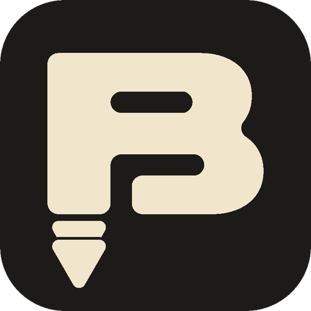

<p align="center">
  
</p>

<h1 align="center">BÁJALO</h1>

<p align="center">
  App de escritorio para Windows con estética retro cassette / VHS.<br>
  Copia un enlace, elige MP4 o MP3 y descarga en la mejor calidad disponible.
</p>

---

## Características

- Detecta automáticamente el enlace que copias (no hace falta pegarlo).
- Descarga **video en MP4** o **audio en MP3 (320 kbps)**.
- Cassette animado: los carretes giran y la cinta avanza según el progreso.
- Funciona con los sitios que soporta [yt-dlp](https://github.com/yt-dlp/yt-dlp) (YouTube, TikTok, Facebook y muchos más).
- El instalador incluye FFmpeg y Deno: no hay que instalar nada más.

## Instalación (usuarios)

1. Ve a la sección **Releases** de este repositorio.
2. Descarga `Instalador-Bajalo.exe` y ejecútalo.
3. Si Windows muestra "editor desconocido", pulsa **Más información → Ejecutar de todos modos** (el instalador aún no está firmado digitalmente).

## Ejecutar desde el código

Requisitos: Python 3.10 o superior y [FFmpeg](https://ffmpeg.org/) en el PATH. Para YouTube también se recomienda [Deno](https://deno.com/).

```
pip install PySide6 "yt-dlp[default]"
python bajalo.py
```

## Construir el instalador

1. Ejecuta `construir.bat` (descarga FFmpeg y Deno, y crea la app con PyInstaller en `dist\Bajalo`).
2. Abre `bajalo.iss` con [Inno Setup](https://jrsoftware.org/isinfo.php) y pulsa **Compilar**.
3. El instalador queda en `instalador\Instalador-Bajalo.exe`.

## Tecnologías

Python · PySide6 (Qt) · yt-dlp · FFmpeg · Deno · PyInstaller · Inno Setup

## Uso responsable

Descargar contenido puede ir en contra de los términos de uso de cada plataforma y de los derechos de autor. Usa Bájalo solo con contenido propio, de licencia libre o con permiso de su autor. Este proyecto no está afiliado a YouTube, TikTok ni Facebook.

## Créditos

Diseño de marca, logo e interfaz: Jair.
Bájalo se apoya en el trabajo de los proyectos yt-dlp, FFmpeg y Deno.
